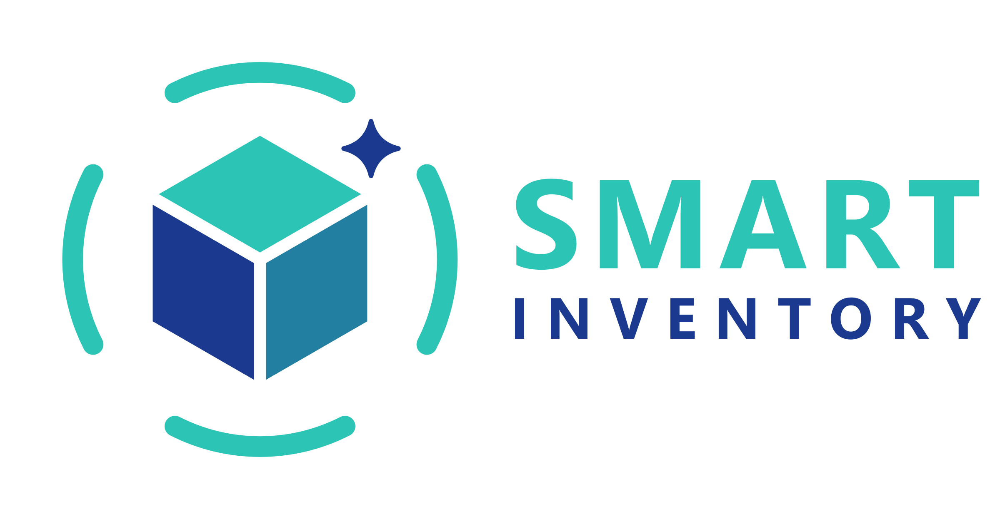

# Backoffice Frontend — Smart Inventory Platform

<p align="center"></p>

[](https://codecov.io/gh/Smart-Inventory-App/BackOffice_Frontend)

Interfaz web del panel de administración (backoffice) de Smart Inventory Platform. Pensada para usuarios regulares y administradores: permite ver el estado general del sistema, gestionar/habilitar usuarios, gestionar y supervisar los productos e imágenes que cargan.

Tiene el **mismo aspecto y la misma lógica de negocio que la app**: la gama de colores (verde azulado `#2CC4B4` y azul `#1B3A8F`, rojo y amarillo para las alertas), los logos nuevos, las pantallas de ingreso y registro, las cuatro tarjetas del inicio, las tendencias de consumo, el Centro de Alertas y el flujo de producto. Es un servicio separado: habla solo con el `backoffice_backend`.

---

## Stack

- Vite + React 18 + TypeScript
- TailwindCSS 3
- React Router 6
- TanStack Query 5 (data fetching)
- Axios (cliente HTTP con interceptor de token)
- Recharts (gráficos del dashboard)
- lucide-react (íconos)

Puerto: **3000** (está habilitado en el CORS del `backoffice_backend`).

---

## Páginas

| Ruta | Descripción |
|------|-------------|
| `/login`, `/register`, `/forgot-password`, `/set-password` | Ingreso en dos pasos (email y contraseña, con el ojo para mostrarla), registro, **recuperar o crear la contraseña** con un código por mail (también para cuentas de Google) y la contraseña del primer ingreso de un administrador |
| `/` | **Dashboard**. Usuario: las cuatro tarjetas de la app, gráficos interactivos, lo que hay que atender, últimos cambios y productos recientes. Administrador: el estado de la plataforma |
| `/alertas` | Centro de Alertas (usuario) |
| `/metricas` | Tendencias, en dos mitades: **Tendencias de consumo** y **Tendencias de ingresos** (las del usuario o, para un administrador, las de toda la plataforma) |
| `/usuarios` | Lista de usuarios, búsqueda y habilitar/deshabilitar |
| `/usuarios/:id` | Detalle de usuario: unidades, alertas, consumo de 30 días, sus alertas y sus productos con el nivel de cada uno |
| `/productos` | Productos cargados (con imagen y nivel de alerta), búsqueda, filtros (incluida la ubicación), orden, exportación, eliminación y **stock total por producto**; el usuario ve su inventario con el **stock total de la lista** arriba a la derecha (cambia con la búsqueda y los filtros, como en la app) y abre la **información de cada producto** al tocar su fila (la misma ventana que la app, con las reglas generales del perfil); filtros de categoría, **marca**, ubicación y vencimiento siempre del mismo tamaño; la marca se elige entre las existentes o se crea una nueva, también en **Editar todo**; cada producto se puede **eliminar** y, con varios elegidos, **Borrar todo** (con confirmación); una «X» deselecciona todo |
| `/auditoria` | Actividad de usuarios: altas, productos, logins y cambios de rol |
| `/ocr` | Módulo de OCR: estado de los motores, tiempos y precisión, prueba de fotos y auditoría de escaneos |
| `/ml` | Modelos de predicción de consumo |
| `/cargar` | Flujo de producto (entrada y salida) en modo usuario, con tres formas de carga: manual, por archivo y **por foto** (pestaña Procesamiento). El formulario manual ocupa todo el ancho y tiene los **mismos campos, textos, límites y verificaciones que la app** (nombre de hasta 20 caracteres y descripción de hasta 400 con su contador, stock de hasta 6 dígitos, fecha como DD/MM/AAAA, código de hasta 14 dígitos, reglas de alerta plegables con los nombres y descripciones de la app; en la salida, el nombre del producto de hasta 20 caracteres, los motivos Vendido / Consumido / Vencido / Alquilado y la descripción de hasta 50). Nombre y stock, marca y categoría, y fecha de vencimiento (con botón de calendario) y código de barras van en el mismo renglón; al registrar una entrada o una salida el formulario se vacía y arriba aparece «Se ha registrado la entrada/salida de X unidades de "producto". Stock actual N.» |
| `/perfil` | Datos de la cuenta, tipo de cuenta y reglas de alerta, en modo usuario |

#### Dashboard del usuario

No es un «inicio»: es un dashboard con la información de su inventario, esté o no en la app del celular. «Dashboard», con **«Bienvenido, <nombre>»** si la persona acaba de iniciar sesión o **«Tu estado, <nombre>»** si cambió de página y volvió (`src/lib/welcome.ts`: un aviso de un solo uso que se deja al ingresar y el dashboard borra); cuatro tarjetas (**Productos** → «Total inventario», **Productos en stock** → «Total unidades», **Vencimientos** → «Alertas de productos», **Stock bajo** → «Alertas de stock», esta última con letra blanca) con los números con puntos de miles. «Vencimientos» abre el Centro de Alertas con **Vencimiento** ya elegido y «Stock bajo» con **Stock**. Debajo, un selector de período (**7, 14, 30 o 90 días**, el 90 es solo del dashboard) y **gráficos que se pueden recorrer y tocar**: consumo por día (con el detalle de cada día al pasar el mouse y el botón «Tendencias») e **ingresos por día** (todas las cargas de stock: reposiciones y el stock inicial de los productos nuevos, con el total, el promedio y el día de mayor ingreso), vencimientos por tramo, ****stock por marca** y **stock por categoría** (las 5 con más unidades en stock; «Ver más» abre la lista completa de mayor a menor, y tocar una abre el inventario filtrado por esa marca o categoría) y productos por ubicación. No hay gráfico de alertas: se llega a ellas desde las tarjetas. Después, «Un vistazo más», «Para atender primero», **Últimos Cambios** y **Productos Recientes** (hasta 5 cada uno).

En la misma pantalla, **«Dónde tenés tus productos»** muestra las 5 ubicaciones con más productos (sin gráfico; «Ver más» abre el listado completo de mayor a menor, `src/components/RankingModal.tsx`, igual que «Stock por categoría»), **«Un vistazo más»** («Datos adicionales del sistema») suma vencidos con stock, alertas críticas y advertencias, productos con imagen y productos sin vencimiento, y **«Para atender primero»** muestra solo las 3 alertas más pertinentes (críticas primero, y las que vencen o se agotan antes) con un «Ver alertas» que lleva al Centro de Alertas. «Dónde tenés tus productos» suma a la derecha «Ver inventario». Las ubicaciones y marcas que se muestran son las que existen de verdad: lo que no tiene ubicación o marca no cuenta. Entre «Últimos Cambios» y «Productos Recientes» hay una línea vertical tenue. Las tres columnas ocupan siempre el mismo alto. El gráfico de ingresos por día es de área y azul, igual que el de consumo, y el botón «Tendencias» lleva a la página de tendencias; en esa página, debajo de los ingresos, se ven los **productos con más stock**.

#### Tendencias (consumo e ingresos)

La página se divide en dos: **Tendencias de consumo** y **Tendencias de ingresos**, con un único selector de período (**7, 14, 30 o 90 días**; con 90 el gráfico rotula una barra por semana). Cada mitad tiene su gráfico por día que se ve **entero, sin desplazarse**, con el día elegido y su detalle **centrado** entre las flechas «<» y «>», el promedio por día, el día de mayor valor (dos renglones) y la comparación con el período anterior; el consumo suma «Consumido», «Repuesto» y los **5 productos más consumidos**, y los ingresos suman «Ingresado». Los días son los de Argentina. Está en `src/components/TrendsPanel.tsx` (`kind="consumo" | "ingresos"`) y `src/pages/Metricas.tsx`.

#### Centro de Alertas

«Críticas» y «Advertencias» son filtros: al tocar una, su contorno es **rojo** o **amarillo**; con las opciones Todas / Stock / Vencimiento los números siguen al tipo elegido. «Según tus reglas» va primero y «Generado por el sistema» después, con la marca «Predicción» fija arriba a la derecha de lo que calcula el modelo. Cada alerta tiene dos renglones de descripción («Quedan X ud. restantes que alcanzan para x días. Mínimo configurado de X días.») y un detalle que se desplaza; en un producto ya vencido no se explica la regla de aviso. Los niveles son los de la app: se avisa con **menos de** N días.

#### Administradores y primer ingreso

**Agregar administrador** está en la barra lateral, justo arriba de la información de la sesión, y **solo lo ve un administrador en su vista de administrador**. La ventana pide el email (no sugiere usuarios): si ya tiene cuenta pasa a ser administrador con su contraseña; si no, el dashboard pide una **contraseña inicial** (se genera una y se puede copiar), crea la cuenta y la muestra para pasársela a la persona. Cuando ingresa por primera vez, el dashboard le exige **cambiarla** antes de usar cualquier otra pantalla (`src/pages/ChangePassword.tsx`).

Cada campo de contraseña tiene **un solo ojo, y es suyo**: mostrar «Contraseña» no muestra «Repetir contraseña». El ojo que agrega el navegador (Edge) se oculta por CSS. Las ventanas de «Agregar administrador» dicen «Crear administrador» cuando la cuenta no existía, y la barra lateral aclara «Viendo como administrador» o «Viendo como usuario» debajo del nombre de la cuenta.

Para quien lo usa, el panel se llama **Dashboard** (el nombre «backoffice» es técnico y no aparece en pantalla).

#### Imágenes de producto

La imagen se **adjunta como archivo** (se elige o se arrastra; JPG, PNG o WebP de hasta 10 MB) con vista previa; el archivo viaja por `POST /me/products/image` y el producto guarda la dirección que devuelve. Ya no se escribe un enlace (`src/components/ImageUpload.tsx`).

#### Imágenes de productos

Toda imagen de un producto se puede tocar para verla **en grande**, en el centro de la pantalla sin ocuparla toda (`src/components/ImageViewer.tsx`, usado por `ProductImage` y por la vista previa de `ImageUpload`): la rueda del mouse hace zoom, una **X** arriba a la derecha (o Escape, o tocar el fondo) la cierra y, desde el celular, **dos toques y arrastrar hacia afuera** agranda la imagen y **al soltar vuelve a su tamaño normal**. En el Detalle de Alerta, los datos del producto muy largos se cortan a 50 caracteres con «...» (como en el resto del dashboard).

#### Perfil

Se ve primero con los datos ya cargados (nombre, apellido, usuario, tipo de cuenta y reglas de alerta) y, a la derecha del encabezado (nombre, mail y tipo de cuenta), un **lápiz** pasa a editar **todos** los campos: nombre, apellido y usuario de hasta 20 caracteres con contador; el usuario se consulta mientras se escribe (**único**, sin distinguir mayúsculas); días de las alertas de 2 a 90 y hora del chequeo de 0 a 23 en hora de Argentina, con botones para subir y bajar; tipo de cuenta (Individuo / Comercio). «Guardar cambios» vuelve a la vista; «Cancelar» descarta lo escrito.

#### Stock total por producto

En `/productos` el botón **Stock total** de cada fila (en la información del producto) abre una ventana con la suma del stock de todos los productos que tienen el mismo nombre y categoría, de cualquier marca (`src/components/StockTotalModal.tsx`). El botón general del encabezado se reemplazó por el resumen «Stock total · N unidades · entre M productos en el inventario»:

- Desde el botón de arriba se **busca por nombre** (a partir de 2 letras, con sugerencias). Si hay un dueño elegido en el filtro de la página, se cuenta solo lo de ese usuario; si no, lo de **toda la plataforma**, y la ventana indica cuántos usuarios suman.
- Desde el botón de una fila se abre directamente con ese producto, acotado al usuario dueño de esa fila.
- El nombre y el resumen (stock total y cantidad de productos) **quedan fijos**; solo se desplaza el listado de «Productos encontrados». Cada producto tiene una casilla para incluirlo o sacarlo de la suma, y el total se recalcula al instante.

El orden por nombre de las tablas de productos es alfabético (no distingue mayúsculas ni tildes) y al ordenar por vencimiento no aparecen los productos sin fecha; lo resuelve el `backoffice_backend`.

La pestaña **Procesamiento** de `/cargar` (`src/components/Procesamiento.tsx`) es la contracara de usuario del mismo módulo: manda la foto a `/me/products/ocr/*`, espera —mostrando el lugar en la fila y la espera estimada, porque un comprobante tarda cerca de un minuto— y devuelve un borrador **ya emparejado** con el inventario de quien escanea. Nada se guarda hasta que la persona confirma, y lo que se confirma va a los endpoints de alta y de salida de siempre. La foto elegida se puede ampliar como las demás imágenes.

La lógica es la de la app: **todo el procesamiento de una entrada es de productos nuevos**. Escanear la etiqueta (`EntradaEtiqueta`) muestra lo leído para corregirlo y, al validarlo, lo pasa todo al formulario de entrada del flujo de producto; un ticket, remito o factura se gestiona aparte, con su carga masiva (`src/components/ReceiptReview.tsx`, la misma para entrada y salida), con el formato de la carga por archivo: la lista de productos a la izquierda y el producto a revisar a la derecha. Cada producto arranca con el texto leído como nombre y, debajo, los productos del inventario parecidos (sin completar ningún otro dato); al elegir uno se ve su información, sin poder editarla, con la opción de elegir otro; si ninguno corresponde, en una entrada se crea un producto nuevo. Se pueden quitar productos y agregar uno a mano, y no se confirma mientras haya productos incompletos o con stock inválido: hay que corregirlos o quitarlos. Los campos de vencimiento y de código de barras del formulario tienen su botón de cámara (`ScanFieldButton`) para escanear solo ese dato. La salida se arma con el código de barras, la etiqueta o un comprobante: con los dos primeros se elige el producto (el mismo recorrido de «Producto existente») y vuelve al formulario de salida con él elegido.

El botón **Producto existente** (`src/components/ExistingProduct.tsx`, a la izquierda de «Entrada») busca un producto ya cargado por su nombre, escaneando su etiqueta o con su código de barras escrito a mano o leído de una foto: se corrige lo leído, se muestran los productos parecidos (o «No existe un producto con la información escaneada», con «Cargar nuevo producto» hacia el formulario de entrada) y, al elegir uno, se ve su información y se ingresa el stock. Lo compartido de los escaneos (`useScan`, `FotoInput`, etc.) está en `src/components/scanTools.tsx`.

En entrada hay tres caminos (imagen del producto, comprobante, código de barras) y en salida dos (código de barras y comprobante): no hay salida por foto del envase porque una etiqueta no dice de qué lote sale el stock. Cuando el código leído no corresponde a ningún producto, el flujo salta al alta manual con el código ya cargado.

La página de OCR habla con `/admin/ocr/*` del backoffice, que a su vez habla con el coordinador del módulo. La foto que se sube desde ahí para probar **no se guarda en ningún lado**: se procesa en memoria y de la ejecución sólo queda un renglón de auditoría con quién la pidió, cuánto tardó y un resumen recortado de lo leído.

---

## Configuración

`.env` (a partir de `.env.example`):

```env
VITE_API_URL=http://localhost:8002
# ID del cliente "Aplicación web" de Google Cloud; vacío = no hay "Continuar con Google"
VITE_GOOGLE_CLIENT_ID=
```

La subida de imágenes pasa por el `backoffice_backend`, así que no hace falta otra dirección.

#### Ingreso con Google

Está implementado **como en la app**: en el paso del email, debajo de «Continuar», una «o» y el botón «Continuar con Google» (mientras entra dice «Conectando...»). Sirve para ingresar y también para crear la cuenta (si es la primera vez, `auth` la crea y manda el mail de bienvenida). No aparece en el paso de la contraseña ni en «Crear cuenta», igual que en la app, y **solo si está definido `VITE_GOOGLE_CLIENT_ID`**.

- Es el **mismo ID de cliente Web** que usa la app como `webClientId` y el servicio `auth` como `GOOGLE_CLIENT_ID`: `auth` comprueba que el idToken lo haya emitido Google para ese cliente. En Google Cloud hay que agregar el **origen del dashboard** (por ejemplo `http://localhost:3000` y la URL de producción) a los «Orígenes de JavaScript autorizados» de ese cliente.
- Se usa Google Identity Services: el botón oficial de Google va (invisible) encima del botón del dashboard para que el clic llegue a Google. Si la persona cierra la ventana de Google no pasa nada; si falla, el error sale en el formulario con los mismos textos que en la app. Al cerrar sesión se le avisa a Google (`disableAutoSelect`) para que la próxima vez deje elegir la cuenta.
- Una cuenta creada con Google que todavía no tiene contraseña recibe, al escribir su email, el aviso «Esta cuenta se creó con Google y todavía no tiene contraseña. Ingresá con Google o creá una contraseña.» con «Crear contraseña» y «Volver al login»; en «Crear cuenta», el email de una cuenta existente se marca al escribirlo («Ya existe una cuenta con ese email.» o «Cuenta de Google»).

---

## Setup local

```powershell
npm install
npm run dev      # http://localhost:3000
```

Requiere el `backoffice_backend` corriendo en `http://localhost:8002` y un administrador creado (ver `backoffice_backend/README.md` → `create_admin.py`).

```powershell
npm run build    # type-check + build de producción
```

---

## Tests

```powershell
npm test                # vitest
npm run test:coverage   # con cobertura (umbral del 90 %)
```

531 tests, 99 % de cobertura de líneas y 92 % de ramas.
